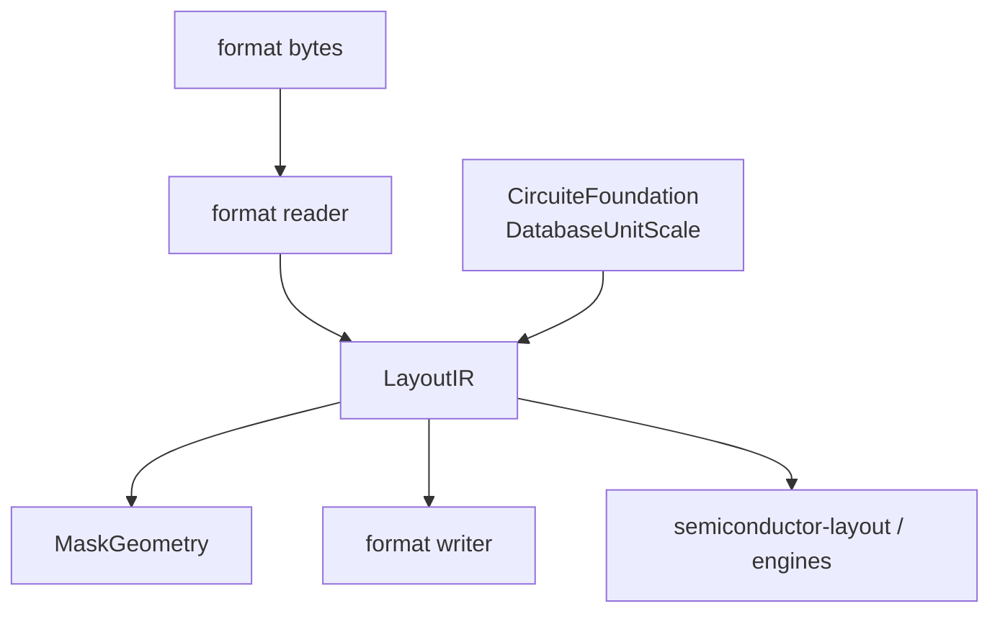

# swift-mask-data design

## Purpose and Scope

The package is the standard-mask-data boundary for independently usable design
tools. It converts files into a stable intermediate representation and provides
geometry operations without knowing how a project is scheduled or approved.
The parent is the [LSI system design](../DESIGN.md). The changed LEF boundary is
owned by the [LEF module design](Sources/LEF/DESIGN.md).

## Responsibilities and Boundaries

| Layer | Owns | Does not own |
|---|---|---|
| `LayoutIR` | Format-neutral geometry, hierarchy references, properties, and units | Physical process-rule interpretation |
| Format codecs | Parsing and serialization of one standard format | Generic project state |
| `TechIR` | Format-neutral technology records | Foundry qualification decisions |
| `MaskGeometry` | Polygon boolean/sizing/connectivity and geometry checks | Electrical netlist semantics |

## Related Designs

| Design | Relationship | Contract Used | Summary | Cautions |
|---|---|---|---|---|
| [LSI](../DESIGN.md) | Parent | Exact standard data and explicit loss | Standalone platform composition | Codec success does not qualify a process |
| [LayoutIR](Sources/LayoutIR/DESIGN.md) | Child | Owned geometry and typed named via placements | Shared representation | Master resolution belongs to technology consumers |
| [OASIS](Sources/OASIS/DESIGN.md) | Child | Standard binary coding and modal paths | Signed physical interchange | Independent-byte evidence is required |
| [LEF](Sources/LEF/DESIGN.md) | Child | Typed parsing and geometry conversion | Physical interchange boundary | Off-grid source geometry is rejected |
| [MaskGeometry](Sources/MaskGeometry/DESIGN.md) | Child | Exact bounded decomposition | Native geometry consumers | Electrical semantics remain downstream |
| [DEF](Sources/DEF/DESIGN.md) | Child | Standard orientation and typed interchange | Shared native geometry meaning | Nonrepresentable transforms are errors |
| [TechIR](Sources/TechIR/DESIGN.md) | Child | Format-neutral layer and grid values | Shared typed process declarations | Conversion must retain both grid axes |
| [CircuiteFoundation](../CircuiteFoundation/DESIGN.md) | Depends on | Validated unit scale | Shared identity and units | Domain rules remain outside the dependency floor |

## Contracts and Invariants

`CircuiteFoundation` is a direct dependency of `LayoutIR`:

- `DatabaseUnitScale` validates positive finite database-unit scales.
- `IRLibrary.databaseUnitScale` owns `DatabaseUnitScale` directly. LayoutIR
  does not define a second unit type or accept an unvalidated raw scale.
- Artifact, provenance, diagnostic, and engine protocols remain available to
  consuming packages; this library does not wrap codec calls in a generic
  engine envelope.

## Architecture

## Exactness policy

`Region.intersection`, `union`, `symmetricDifference`, and `subtracting` use
only the exact rectilinear kernel. They throw
`RegionBooleanError.unsupportedNonManhattanGeometry` for unsupported geometry.
There is no public approximate fallback path, so every consumer observes the
same failure contract.

## Extension point for implementation agents

Agents adding a new format should add a codec target/file set, map it to
`LayoutIR`, preserve typed parse/write errors, and add round-trip fixtures. They
should not add project/run state or duplicate `DatabaseUnitScale` validation.

## Verification and Change Impact

Each codec's test target owns parsing, failure and round-trip behavior. Changes to
LEF geometry conversion require `LEFTests` and the package integration tests;
consumers must separately prove their process mapping and qualification gates.
