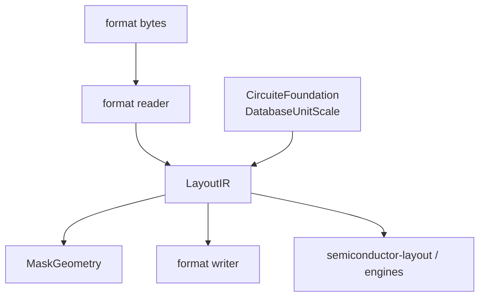

# swift-mask-data design

## Purpose and Scope

The package is the standard-mask-data boundary for independently usable design
tools. It converts files into a stable intermediate representation and provides
geometry operations without knowing how a project is scheduled or approved.
The parent is the [LSI system design](../DESIGN.md). The changed LEF boundary is
owned by the [LEF module design](Sources/LEF/DESIGN.md).

## Responsibilities and Boundaries

| Layer | Owns | Does not own |
|---|---|---|
| `LayoutIR` | Format-neutral geometry, hierarchy references, properties, and units | Physical process-rule interpretation |
| Format codecs | Parsing and serialization of one standard format | Generic project state |
| `TechIR` | Format-neutral technology records | Foundry qualification decisions |
| `MaskGeometry` | Polygon boolean/sizing/connectivity and geometry checks | Electrical netlist semantics |

## Related Designs

| Design | Relationship | Contract Used | Summary | Cautions |
|---|---|---|---|---|
| [LSI](../DESIGN.md) | Parent | Exact standard data and explicit loss | Standalone platform composition | Codec success does not qualify a process |
| [LayoutIR](Sources/LayoutIR/DESIGN.md) | Child | Owned geometry and typed named via placements | Shared representation | Master resolution belongs to technology consumers |
| [OASIS](Sources/OASIS/DESIGN.md) | Child | Standard binary coding and modal paths | Signed physical interchange | Independent-byte evidence is required |
| [LEF](Sources/LEF/DESIGN.md) | Child | Typed parsing and geometry conversion | Physical interchange boundary | Off-grid source geometry is rejected |
| [MaskGeometry](Sources/MaskGeometry/DESIGN.md) | Child | Exact bounded decomposition | Native geometry consumers | Electrical semantics remain downstream |
| [DEF](Sources/DEF/DESIGN.md) | Child | Standard orientation and typed interchange | Shared native geometry meaning | Nonrepresentable transforms are errors |
| [TechIR](Sources/TechIR/DESIGN.md) | Child | Format-neutral layer and grid values | Shared typed process declarations | Conversion must retain both grid axes |
| [CircuiteFoundation](../CircuiteFoundation/DESIGN.md) | Depends on | Validated unit scale | Shared identity and units | Domain rules remain outside the dependency floor |

## Contracts and Invariants

`CircuiteFoundation` is a direct dependency of `LayoutIR`:

- `DatabaseUnitScale` validates positive finite database-unit scales.
- `IRLibrary.databaseUnitScale` owns `DatabaseUnitScale` directly. LayoutIR
  does not define a second unit type or accept an unvalidated raw scale.
- Artifact, provenance, diagnostic, and engine protocols remain available to
  consuming packages; this library does not wrap codec calls in a generic
  engine envelope.

## Architecture

## Exactness policy

`Region.intersection`, `union`, `symmetricDifference`, and `subtracting` use
only the exact rectilinear kernel. They throw
`RegionBooleanError.unsupportedNonManhattanGeometry` for unsupported geometry.
There is no public approximate fallback path, so every consumer observes the
same failure contract.

## Extension point for implementation agents

Agents adding a new format should add a codec target/file set, map it to
`LayoutIR`, preserve typed parse/write errors, and add round-trip fixtures. They
should not add project/run state or duplicate `DatabaseUnitScale` validation.

## Verification and Change Impact

### GDS and DXF preservation boundaries

GDS has element PROPERTY records, not cell-scoped properties. Nonempty
IRCell.properties fail with GDSError before returning bytes; element property
attributes, order and values and supported TEXT poses remain preserved.
CIF and DXF likewise reject cell properties: their current standard profile has
no cell-property mapping. This does not change their representable geometry,
hierarchy or existing element-property failure contract.
Nonempty IRLibrary.metadata is retained by the OASIS named-string profile;
GDS, CIF, DXF and the LEF OBS projection reject library metadata that their
existing standard mapping cannot represent. Writer success never erases it.

DXF INSERT maps negative X scale to LayoutIR's reflection-about-X convention
with an additional half-turn. MINSERT grid offsets rotate by the DXF rotation;
they do not scale or mirror with block geometry. Reader and writer retain both
world vector components. Writer computes AREF deltas in Int64 and admits only
vectors reconstructible from standard column/row spacings at the selected
rotation. Skew or incompatible vectors fail rather than losing a component.
Quarter-turn rotation uses exact coordinate permutations. Existing caller-owned
DXF coordinate truncation is retained for genuine sub-DBU source coordinates.
Values within one ULP of an integer restore that integer to avoid loss from
decimal/DBU multiplication noise; larger fractions still truncate toward zero.
Exact IR array export additionally proves that read-back endpoints are identical.
These operations use invocation-local value state, with the same Sendable and
isolation contracts across targets. The
[Autodesk INSERT reference](https://help.autodesk.com/cloudhelp/2018/ENU/AutoCAD-DXF/files/GUID-28FA4CFB-9D5E-4880-9F11-36C97578252F.htm)
owns the group codes; the independent
[ezdxf MINSERT implementation](https://github.com/mozman/ezdxf/blob/master/src/ezdxf/entities/insert.py)
provides the rotation-only grid oracle.

Each codec's test target owns parsing, failure and round-trip behavior. Changes to
LEF geometry conversion require `LEFTests` and the package integration tests;
consumers must separately prove their process mapping and qualification gates.

### Foundation revision compatibility

The exact `c952ac5ebe3c21bf0cbd6d6ac239130efd732b3a` dependency preserves the
consumed Core and Foundation conversion sources from
`ae88104c556f5802819713ed741f5b2fffffc2d9`; its platform-link addition applies
only to Linux. This package does not consume the changed FileSystem product.
Production and test sources remain unchanged from `c00511a`.
Native adoption exercises shared unit-scale admission and coding plus standard
OASIS writer/reader success and refusal. Prior codec and independent-oracle
evidence retains its original scope. Exact graph, source hashes and execution
results belong to the
[compatibility evidence](../.verification/runs/s3-stageIII-20261013-2e1f3af7/s3m-mask/completion.json);
this adoption does not establish process or release qualification.

## Public source-floor prerequisite

This snapshot preserves the implementation, tests, and resources at
`83c926044838fe12f579bc9d2526a8e55899fa60`, with the public exact HTTPS
CircuiteFoundation dependency `5f132c58209123433e0e479e1ea61096e46061ba`.
It retains the published MIT license for repository-owned code and preserves
existing source, resource, and third-party notices. The license does not grant
rights to external model, compiler, or process artifacts.

The technology schema retains ordered oxide-scoped antenna statements and
qualified cut-layer enclosure arrays. Consumers must apply those exact laws or
refuse them explicitly. The legacy single `enclosure` view returns a value only
for one unqualified declaration. Legacy JSON migrates to the ordered array;
conflicting old/new keys are rejected. New source output uses `enclosures`.
Unsupported conditional enclosure forms and lossy geometry projections remain
explicit failures; retention is not physical-rule or process qualification.
See [Technology Enclosure](Sources/TechIR/TechnologyEnclosure/DESIGN.md),
[Technology Antenna](Sources/TechIR/TechnologyAntenna/DESIGN.md), and
[LEF Codec](Sources/LEF/Codec/DESIGN.md) for the owning contracts.

Qualification is limited to the original native TechIR, LEF, and DEF tests and
subsequent consuming Layout admission controls. It does not qualify all mask
formats, editor/Metal execution, or foundry signoff. No parser implementation,
test assertion, fixture, or runtime limit is changed by this prerequisite.
