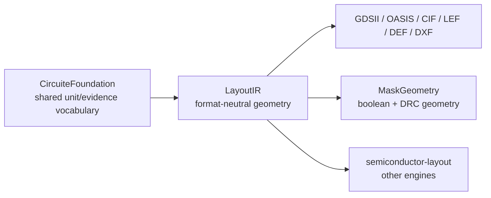

# swift-mask-data

`swift-mask-data` is an independent Swift library for reading, writing, and
manipulating semiconductor mask data. It provides format-specific codecs and a
format-neutral layout/technology IR. It does not own a project lifecycle,
design-flow scheduler, or foundry signoff policy.

## Xcircuite integration

[`Xcircuite`](https://github.com/1amageek/Xcircuite) is the umbrella runtime
that consumes this package's standard mask-data artifacts at layout, DRC, LVS,
and PEX stage boundaries. `swift-mask-data` remains independently usable and
owns format codecs, mask geometry, and the format-neutral layout/technology IR.

## Boundary with CircuiteFoundation



`LayoutIR.IRLibrary` stores
`CircuiteFoundation.DatabaseUnitScale` directly. Every codec receives or
decodes a validated scale before coordinate conversion, so an unvalidated raw
floating-point scale cannot enter the format-neutral layout model.

## Modules

| Module | Responsibility |
|---|---|
| `LayoutIR` | Shared cells, elements, coordinates, transforms, properties, and units |
| `GDSII` | GDSII Stream reader/writer |
| `OASIS` | OASIS 1.0 reader/writer |
| `CIF` | Caltech Intermediate Form reader/writer |
| `LEF` | Library Exchange Format reader/writer |
| `DEF` | Design Exchange Format reader/writer |
| `DXF` | Drawing Exchange Format reader/writer |
| `TechIR` | Codable technology IR for layers, vias, and rules |
| `FormatDetector` | Input format detection |
| `MaskGeometry` | Boolean, sizing, connectivity, and geometry-level DRC operations |

## Guarantees and boundaries

- All public IR values are `Codable`, `Hashable`, and `Sendable`.
- Format codecs preserve representable standard data and fail with typed errors
  for malformed input.
- `Region.intersection`, `union`, `symmetricDifference`, and `subtracting`
  are throwing exact operations. They reject unsupported non-Manhattan
  geometry instead of silently selecting an approximate kernel.
- Geometry algorithms remain owned by `MaskGeometry`; Foundation only supplies
  cross-package vocabulary and validated unit conversion.

## Build and test

```bash
swift build
swift test
```

The package requires Swift 6.3 or later and macOS 26 or later. See `DESIGN.md`,
`REQUIREMENTS.md`, and `GOAL_STATUS.md` for implementation-agent guidance.

## Public source-floor prerequisite

This snapshot preserves the implementation, tests, and resources at
`83c926044838fe12f579bc9d2526a8e55899fa60`, with the public exact HTTPS
CircuiteFoundation dependency exact `26.1021.0`, released at
`4d03b5a561c82a756aaf93860f657733371538dc`.
It retains the published MIT license for repository-owned code and preserves
existing source, resource, and third-party notices. The license does not grant
rights to external model, compiler, or process artifacts.

The technology schema retains ordered oxide-scoped antenna statements and
qualified cut-layer enclosure arrays. Consumers must apply those exact laws or
refuse them explicitly. The legacy single `enclosure` view returns a value only
for one unqualified declaration. Legacy JSON migrates to the ordered array;
conflicting old/new keys are rejected. New source output uses `enclosures`.
Unsupported conditional enclosure forms and lossy geometry projections remain
explicit failures; retention is not physical-rule or process qualification.
See [Technology Enclosure](Sources/TechIR/TechnologyEnclosure/DESIGN.md),
[Technology Antenna](Sources/TechIR/TechnologyAntenna/DESIGN.md), and
[LEF Codec](Sources/LEF/Codec/DESIGN.md) for the owning contracts.

Qualification is limited to the original native TechIR, LEF, and DEF tests and
subsequent consuming Layout admission controls. It does not qualify all mask
formats, editor/Metal execution, or foundry signoff. No parser implementation,
test assertion, fixture, or runtime limit is changed by this prerequisite.

## Stable dependency successor preparation

This candidate preserves public `67410f834bdfa8a098c2ec0bfe3675210f658277`
implementation, tests, resources and licenses. Canonical HTTPS resolution selects
CF exact `26.1021.0`; focused Native TechIR/LEF/DEF checks pass within the finite
scope recorded in the [package contract](DESIGN.md#stable-dependency-successor-preparation).
The seven original externally gated LEF checks are not new PDK evidence.
