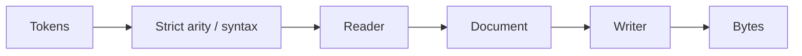
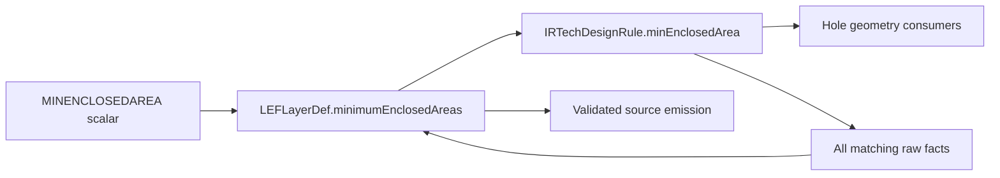

# LEF Codec

## Purpose and Scope

Own `LEFLibraryReader`, `LEFLibraryWriter`, and `LEFStrictValidator`.
Parent: [LEF](../DESIGN.md). No children.

## Responsibilities and Boundaries

Parse and write supported standard declarations. Reject unsupported commands and
numeric arity before a parser branch can discard input. Engines own capability
selection and qualification.
Statements are accepted only in contexts whose parser retains them. Unmodeled
global controls and obstruction via statements fail explicitly
until the standard schema and parser own their meaning. VIA header qualifiers
end before the first body statement, with or without a header semicolon.

## Related Designs

| Design | Relationship | Contract Used | Summary | Cautions |
|---|---|---|---|---|
| [LEF](../DESIGN.md) | Parent | LEFDocument and typed errors | Public codec entry points | Unsupported declarations must fail explicitly |
| [PhysicalSchema](../PhysicalSchema/DESIGN.md) | Depends on | Layer axis declarations | Preserve both values | Writer must retain scalar versus pair |

## Architecture

## Contracts and Invariants

PITCH/OFFSET admit one or two finite numbers; WIDTH and unqualified SPACING admit
one. Extra values fail. Programmatic grid values must be finite before writing.
Physical meaning is retained at this boundary; downstream projections require
their own exactness evidence.

PORT/OBS WIDTH and PATH retain actual ordered geometry. Each PATH requires a
previous positive WIDTH in the same LAYER segment; a new LAYER clears width.
Repeated WIDTH/PATH statements are legal and each path owns its selected width.
PATH has one or more points and nonzero orthogonal segments, with half-width
endpoint extension, as specified by the
[LEF 5.8 reference](https://coriolis.lip6.fr/doc/lefdef/lefdefref/LEFSyntax.html).
Unsupported PATH MASK/ITERATE variants and missing/invalid width fail explicitly.

PARALLELRUNLENGTH spacing tables use the standard single final semicolon, with
WIDTH delimiting complete matrix rows. The reader also preserves its previously
accepted header/row-semicolon spelling; the writer emits standard grammar only.
Axes are nonempty, finite and strictly increasing; width is nonnegative and
parallel-length thresholds retain their sign. Each row has one nonnegative
spacing per length column. Spacing cannot decrease along width
or parallel-length axes. Reader and writer validate the same retained table.
Adjacent layer WIDTH and SPACING statements remain outside the table scope.
This codec contract retains micron thresholds and does not select process spacing.
The [LEF 5.8 standard](https://coriolis.lip6.fr/doc/lefdef/lefdefref/LEFSyntax.html)
forbids unqualified SPACING with SPACINGTABLE; reader and writer reject this
contradictory layer definition instead of selecting an arbitrary rule.

The optional document-level `manufacturingGrid` retains microns from
MANUFACTURINGGRID. Source and writer require exactly one finite positive value;
repeated and nested declarations fail. Absence stays absent, including legacy
serialized documents. Retention does not imply a consumer enforces this grid;
process geometry consumers must verify exact DBU conversion and legality.

UNITS retains TIME NANOSECONDS, CAPACITANCE PICOFARADS, RESISTANCE OHMS,
POWER MILLIWATTS, CURRENT MILLIAMPS, VOLTAGE VOLTS and FREQUENCY MEGAHERTZ
precision declarations through [TechnologyUnits](../../TechIR/TechnologyUnits/DESIGN.md).
Each requires its exact unit name and one finite positive factor. Source and writer
validate the same declarations. Numeric layer/via quantities are not multiplied
by these precision facts during parsing or library projection. UNITS must precede
LAYER and cannot repeat; duplicate dimensions and wrong contexts fail.

DATABASE MICRONS admits the standard factors 100, 200, 400, 800, 1000, 2000,
4000, 8000, 10000 and 20000. The reader uses the standard 100 when omitted,
including a missing UNITS block. Programmatic LEFDocument construction retains
its existing explicit convenience default of 1000; its writer declares that value.
The independent `hasDatabaseUnitsDeclaration` fact retains explicit versus
omitted DATABASE through writer, JSON and TechIR projection. A standalone implicit
record must retain resolution 100; writer rejects a contradictory programmatic
record instead of silently declaring or rescaling it. An assembly owner may resolve
implicit incremental views against its exact technology context. Legacy serialized
documents retain their stored resolution as explicit rather than fabricating source
absence. The
[LEF 5.8 Units and Convert Factors specification](https://coriolis.lip6.fr/doc/lefdef/lefdefref/LEFSyntax.html)
owns these rules. Consumers must separately check source/output precision compatibility.

USEMINSPACING OBS ON/OFF is retained as the optional document/library
`obstructionSpacingUsesMinimumWidth` fact. Absence remains absent through writer,
JSON and TechIR projection; legacy values decode nil. Source accepts only OBS
and the two standard keywords, with one library-level occurrence. The
[LEF 5.8 Use Min Spacing specification](https://coriolis.lip6.fr/doc/lefdef/lefdefref/LEFSyntax.html)
defines default ON and prohibits mixed abstract policies. Native assembly owns
context resolution and actual OBS width interpretation; parsing grants no DRC verdict.

## Verification and Change Impact

[LEFReaderEdgeCaseTests](../../../Tests/LEFTests/LEFEdgeCaseTests.swift) owns
asymmetric two-axis round trips and rejected extra values. LEFTests verifies
codec composition; native track consumers must select the correct axis.

[LEFStandardSpacingTableTests](../../../Tests/LEFTests/LEFStandardSpacingTableTests.swift)
checks real grammar, canonical output, legacy intake, row/column completeness,
nonmonotonic and nonfinite input, and reader/writer rejection parity. Native
consumers must separately prove DBU conversion and actual geometric rule use.

[LEFManufacturingGridTests](../../../Tests/LEFTests/LEFManufacturingGridTests.swift)
verifies source/value/standard and JSON round trips, legacy absence, invalid
numbers, duplicate declarations and illegal nested contexts.

[LEFUnitTests](../../../Tests/LEFTests/LEFUnitTests.swift) owns all unit dimensions,
wrong names/arity/numbers/context/duplicates/order, legacy and standard default semantics.

[LEFObstructionSpacingTests](../../../Tests/LEFTests/LEFObstructionSpacingTests.swift)
owns ON/OFF/absence, source/writer/JSON/TechIR, invalid names/contexts/duplicates
and legacy missing-field behavior.

PROPERTYDEFINITIONS retains typed object/name/type declarations through
[TechnologyProperties](../../TechIR/TechnologyProperties/DESIGN.md). The optional
single library-scope block accepts INTEGER, REAL and STRING; RANGE is numeric,
ordered and inclusive, and a definition value is permitted only on LIBRARY.
Names are unique per object type; missing semicolons, wrong nesting, unknown
objects/types and unrepresentable numeric declarations fail. INTEGER uses exact
Int64 lexical validation; REAL is finite Double. Writer and projection validate
the same contract. Empty and absent definition lists have the same meaning.
Layer PROPERTY assignments retain their declared INTEGER, REAL or STRING type,
source numeric spelling and value through writer, JSON and TechIR. Definitions
must precede their use, match LAYER and the exact property name, and agree with
the assigned type/range. One assignment per name is supported; repeats fail.
STRING values require quotes; unescaped embedded quotes are unsupported.
Legacy serialized layers without assignments decode empty.

LEF58_TYPE requires a STRING declaration and exactly `TYPE <subtype> ;` within
the string. ROUTING admits POLYROUTING; MASTERSLICE admits NWELL, PWELL,
ABOVEDIEEDGE, BELOWDIEEDGE, DIFFUSION, TRIMPOLY, TRIMMETAL and REGION as
specified by the [LEF 5.8 type rule](https://coriolis.lip6.fr/doc/lefdef/lefdefref/LEFSyntax.html).
The layer's typed subtype is a checked semantic projection of this assignment;
source assignment is authoritative and disagreement fails at writer/projection.
Unknown subtype or wrong base layer fails. Other declared properties are retained
without applying process rules. Process consumers must explicitly admit each
assigned property and subtype; codec success never qualifies them. Unknown or
unimplemented process applications must fail in consumers, rather than dropping
retained facts. Legacy layers have no subtype.

[LEFLayerPropertyTests](../../../Tests/LEFTests/LEFLayerPropertyTests.swift)
owns assignment success/failure, exact values, subtype context, source/writer/
JSON/TechIR preservation and legacy defaults. Real unchanged Sky130 prefixes
through the pwell layer prove NWELL/PWELL intake. Full-source outcomes belong to
[Via Generation Formulas](#via-generation-formulas). Legacy serialized roots
without definitions decode empty.

## Layer Antenna Declarations

Layer ANTENNAMODEL OXIDE1 through OXIDE4 and ANTENNADIFFAREARATIO /
ANTENNADIFFSIDEAREARATIO scalar or PWL forms retain their exact value sequence in
[TechnologyAntenna](../../TechIR/TechnologyAntenna/DESIGN.md). Parentheses are
punctuation independently of whitespace; quoted strings remain opaque. Model
switches and repeated laws retain source ordering. Validation admits area laws
on routing/cut layers and sidewall laws on routing layers only. Scalar values and
PWL coordinates must be finite/nonnegative; PWL requires at least two points
with strictly increasing diffusion areas. Writer and LEF-to-TechIR projection
validate the same laws. Other ANTENNA commands still fail explicitly, and
qualified ENCLOSURE is not enabled by antenna retention.

[LEFLayerAntennaTests](../../../Tests/LEFTests/LEFLayerAntennaTests.swift)
owns behavioral success/failure, source/writer/JSON/TechIR, scope/repetition and
legacy absence. Unchanged Sky130 nom/min/max prefixes through END li1 exercise
actual source PWL. Full-source outcomes belong to
[Via Generation Formulas](#via-generation-formulas).

## Layer Enclosure Declarations

CUT-layer ENCLOSURE optionally accepts ABOVE or BELOW and exactly two finite
signed overhangs in microns. Repeated statements retain their ordered alternatives
through [TechnologyEnclosure](../../TechIR/TechnologyEnclosure/DESIGN.md).
WIDTH, LENGTH and EXCEPTEXTRACUT variants fail explicitly until retained and
interpreted. Source, writer and forward technology projection validate the same
subset; reverse projection preserves raw facts for writer validation.
Qualified declarations are not flattened to a scalar enclosure or an unqualified
legacy view. The VIA four-value ENCLOSURE grammar remains unchanged.
[LEFLayerEnclosureTests](../../../Tests/LEFTests/LEFLayerEnclosureTests.swift)
owns behavioral evidence and unchanged Sky130 prefix intake. Full-source outcomes
belong to [Via Generation Formulas](#via-generation-formulas); codec intake is not
physical process qualification.

## Layer Resistance Quantities

ROUTING `RESISTANCE RPERSQ value` retains sheet ohms per square in `resistance`.
CUT `RESISTANCE value` retains ohms per individual cut in `cutResistanceOhms`.
Source, writer and forward projection require finite nonnegative scalars and
matching layer contexts. A layer cannot hold both quantities. The supported
subset has one declaration per layer; duplicate, wrong-context and unknown
forms fail. Routing width-dependent PWL resistance remains explicitly unsupported.
VIA's separate scalar resistance remains total via ohms and is unchanged.
The [LEF 5.8 reference](https://coriolis.lip6.fr/doc/lefdef/lefdefref/LEFSyntax.html)
requires per-cut values to be combined using actual via connectivity; this codec
never fabricates that aggregate or derives it from cut count alone. Electrical
UNITS statements specify precision and do not rescale these retained quantities.

Legacy JSON's `resistance` remains a sheet quantity even on invalid CUT records;
it is preserved for inspection and rejected on source emission/projection rather
than silently reinterpreted. Missing `cutResistanceOhms` remains absent. Reverse
projection retains invalid raw facts for writer refusal.
[LEFLayerResistanceTests](../../../Tests/LEFTests/LEFLayerResistanceTests.swift)
owns source/writer/JSON/TechIR success/failure, distinct units and legacy behavior.
Unchanged Sky130 prefixes through the mcon diffusion antenna rule retain actual
per-cut resistance. Full-source outcomes belong to
[Via Generation Formulas](#via-generation-formulas). Native/layout consumers must explicitly admit or
refuse the new cut quantity before dependency adoption; codec retention does not
establish electrical extraction or physical signoff.

## Scalar Layer Current Density

DCCURRENTDENSITY AVERAGE and ACCURRENTDENSITY PEAK/AVERAGE/RMS accept exactly
one finite nonnegative scalar in CUT or ROUTING layers. Each kind occurs at most
once in a layer; different kinds are independent and retain source ordering.
[TechnologyCurrentDensity](../../TechIR/TechnologyCurrentDensity/DESIGN.md)
owns unit authority and the electrical interpretation boundary. CUT values retain
mA per square micron, ROUTING values mA per micron, without CURRENT precision
rescaling. Source comments do not redefine those units. FREQUENCY/WIDTH/CUTAREA/
TABLEENTRIES forms are explicit unsupported failures; no partial table is accepted.
Writer and forward projection validate the same contexts, units and kind uniqueness.
Reverse projection retains raw values for writer refusal rather than changing units.
[LEFLayerCurrentDensityTests](../../../Tests/LEFTests/LEFLayerCurrentDensityTests.swift)
owns behavioral success/failure and unchanged actual-source prefix/full refusal.

## Minimum Enclosed Hole Area

The supported profile of [LEF 5.8 MINENCLOSEDAREA](https://coriolis.lip6.fr/doc/lefdef/lefdefref/LEFSyntax.html#RoutingMinEnclosedArea)
is one unqualified finite nonnegative scalar per ROUTING layer. It bounds the
empty hole enclosed by metal, in square microns, independently of AREA's metal
island limit. DATABASE precision never rescales it. The standard optional WIDTH
condition applies when any enclosing wire is strictly wider than its threshold;
this profile explicitly refuses WIDTH rather than turning it into an unconditional
limit. Repeated unqualified declarations and all other variants are refused.

LEFLayerDef.minimumEnclosedAreas retains raw area facts as an ordered array, empty
when absent. A valid supported layer has zero or one element. The source-side
array also preserves ambiguous duplicate facts arriving from the existing
nonthrowing reverse projection, so writer validation refuses them instead of
selecting the first. Legacy JSON without the array decodes empty. Invalid raw
JSON remains inspectable and is refused by writer and forward projection.
IRTechDesignRule.minEnclosedArea is the sole format-neutral authority for the
supported unqualified law; no new island-area or layer-field copy is introduced.
A hole-only layer produces a design rule. Reverse projection gathers all matching
non-nil hole facts, including invalid values, into the retained source array.

[LEF minimum enclosed area tests](../../../Tests/LEFTests/LEFMinimumEnclosedAreaTests.swift)
own scalar source/writer/JSON/TechIR behavior, absence versus explicit zero,
context/duplicate/WIDTH refusal and unchanged original three-corner probes.
LayoutIO's IRTechLayoutConverter already maps the matching IR field to
LayoutLayerRuleSet and LayoutDRCService compares merged polygon holes; Native
ProcessGeometry does not yet apply this law. Consumer application and real-PDK
manufacturing qualification remain separate work and are required before claiming
that the retained hole law has been enforced.

## Via Generation Formulas

The supported [LEF 5.8 Via Rule Generate](https://coriolis.lip6.fr/doc/lefdef/lefdefref/LEFSyntax.html#ViaRuleGenerate)
profile retains GENERATE, exactly two routing LAYER/ENCLOSURE records followed
by one cut LAYER with RECT and SPACING x BY y. The shared value contract belongs
to [TechnologyViaGeneration](../../TechIR/TechnologyViaGeneration/DESIGN.md).
Strict preflight parses the whole block and matched END; the reader never skips
an accepted rule. No routing preference, via dimensions or cut count are inferred.

Non-GENERATE, DEFAULT, WIDTH, RESISTANCE, PROPERTY and obsolete direction forms
fail explicitly rather than losing selectors or optional electrical facts. A
valid supported rule references exactly two unambiguous ROUTING declarations and
one CUT declaration. Duplicate rule names, duplicate layer names within the rule,
wrong arity/context, invalid coordinates, nonpositive spacing and reserved DEFAULT
names fail. Writer and forward projection apply the same rule validation; the
nonthrowing reverse projection retains every raw rule for writer refusal.

`LEFDocument.viaGenerationRules` and `IRTechLibrary.viaGenerationRules` share the
same ordered records, empty in legacy JSON. Existing instantiated VIA handling is
unchanged. In particular, the presence of a formula never materializes an implicit
VIA or rewrites an existing VIA's geometry. Source/writer/JSON/IR tests and raw
three-corner proofs belong to
[LEFViaGenerationRuleTests](../../../Tests/LEFTests/LEFViaGenerationRuleTests.swift).
Consumer capability gates and real geometric generation are required separately
before adopting this contract into Native or Layout process applications.

Unchanged Sky130 nom/min/max full technology LEFs each accept 25 retained formulas
and 25 explicit fixed VIAs under this profile. Prefixes through the first formula
and full source round-trip through writer and JSON; formula facts also round-trip
through TechIR. No next unsupported keyword was observed in those three files.
This result is limited to source retention: it does not certify standard-cell LEF
coverage, generated geometry, downstream projections or real-PDK qualification.
