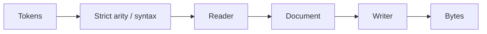

# LEF Codec

## Purpose and Scope

Own `LEFLibraryReader`, `LEFLibraryWriter`, and `LEFStrictValidator`.
Parent: [LEF](../DESIGN.md). No children.

## Responsibilities and Boundaries

Parse and write supported standard declarations. Reject unsupported commands and
numeric arity before a parser branch can discard input. Engines own capability
selection and qualification.
Statements are accepted only in contexts whose parser retains them. Unmodeled
global controls, layer properties and obstruction via statements fail explicitly
until the standard schema and parser own their meaning. VIA header qualifiers
end before the first body statement, with or without a header semicolon.

## Related Designs

| Design | Relationship | Contract Used | Summary | Cautions |
|---|---|---|---|---|
| [LEF](../DESIGN.md) | Parent | LEFDocument and typed errors | Public codec entry points | Unsupported declarations must fail explicitly |
| [PhysicalSchema](../PhysicalSchema/DESIGN.md) | Depends on | Layer axis declarations | Preserve both values | Writer must retain scalar versus pair |

## Architecture

## Contracts and Invariants

PITCH/OFFSET admit one or two finite numbers; WIDTH and unqualified SPACING admit
one. Extra values fail. Programmatic grid values must be finite before writing.
Physical meaning is retained at this boundary; downstream projections require
their own exactness evidence.

## Verification and Change Impact

[LEFReaderEdgeCaseTests](../../../Tests/LEFTests/LEFEdgeCaseTests.swift) owns
asymmetric two-axis round trips and rejected extra values. LEFTests verifies
codec composition; native track consumers must select the correct axis.
