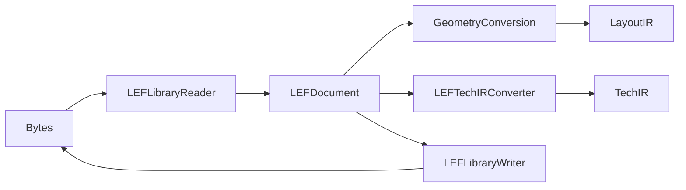

# LEF

## Purpose and Scope

This module owns LEF parsing, writing and explicit projections into LayoutIR and
TechIR. Parent: [swift-mask-data](../../DESIGN.md). Child:
[GeometryConversion](GeometryConversion/DESIGN.md),
[Codec](Codec/DESIGN.md), and [PhysicalSchema](PhysicalSchema/DESIGN.md).

## Responsibilities and Boundaries

The reader retains supported LEF declarations. The geometry converter owns the
micrometer-to-DBU boundary; process interpretation and qualification belong to
consumers. Generated labels are display data, not physical pin access shapes.

## Related Designs

| Design | Relationship | Contract Used | Summary | Cautions |
|---|---|---|---|---|
| [Package](../../DESIGN.md) | Parent | Exact standard boundary | Independent codec product | Parsing alone is not full semantic closure |
| [GeometryConversion](GeometryConversion/DESIGN.md) | Child | Exact physical coordinates | LEF to LayoutIR conversion | Source geometry cannot be silently rounded |
| [Codec](Codec/DESIGN.md) | Child | Strict reader/writer | Standard declarations | Unsupported arity fails rather than dropping values |
| [PhysicalSchema](PhysicalSchema/DESIGN.md) | Child | Typed physical layer declarations | Numeric layer semantics | Scalar and two-axis grids remain distinguishable |
| [PDKKit](../../../PDKKit/DESIGN.md) | Used by | LEFDocument and typed errors | Process-view inspection | Inventory success does not prove executable process semantics |

## Architecture

## Contracts and Invariants

Unsupported syntax and invalid numeric input fail explicitly. Supported source
physical coordinates must be representable on the document's DBU grid and within
LayoutIR's Int32 range. Binary floating-point noise is distinguished from actual
sub-DBU geometry at the conversion boundary.
`PITCH` and `OFFSET` retain either a scalar or an explicit X/Y pair. Their
representation is shared with TechIR; consumers select the relevant axis rather
than assuming the first value is the routing pitch. Scalar numeric statements
must have exactly their supported arity.

## Verification and Change Impact

[LEFTests](../../Tests/LEFTests) owns parser, conversion and error behavior.
Geometry changes first prove the child contract, then the LEF and package paths.
Consumers retaining LEFDocument must verify their own semantic projection; this
module's tests do not prove native placement, routing or extraction.
