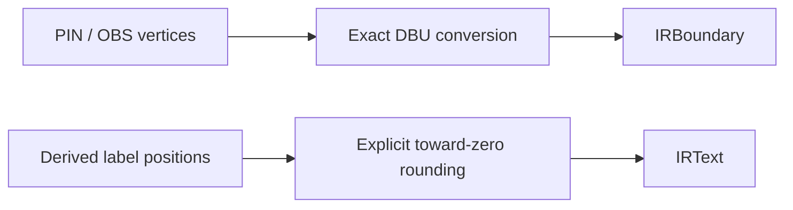

# LEF Geometry Conversion

## Purpose and Scope

Own `LEFIRConverter` and its internal coordinate conversion. Parent:
[LEF](../DESIGN.md). No children.

## Responsibilities and Boundaries

Preserve supported PIN/OBS physical vertices during micrometer-to-DBU import.
Generate pin labels with explicit rounding. This component does not interpret
foundry rules, select routing access points or establish process qualification.

## Related Designs

| Design | Relationship | Contract Used | Summary | Cautions |
|---|---|---|---|---|
| [LEF](../DESIGN.md) | Parent | LEFDocument and LEFError | Public conversion entry point | Broader interchange completeness remains separately tracked |
| [CircuiteFoundation](../../../../CircuiteFoundation/DESIGN.md) | Depends on | DatabaseUnitScale | Positive finite scale | Explicit display rounding does not authorize physical rounding |

## Architecture

## Contracts and Invariants

- Physical coordinates round to the nearest integer only when the difference is
  at most one ULP of the scaled Double, accounting for binary multiplication
  noise. Larger differences fail with a typed off-grid error.
- Non-finite values and values outside Int32 fail before integer conversion.
- Label positions explicitly round toward zero. This never changes physical
  vertices and permits labels for shapes with half-DBU centers.
- All conversion state is local to the synchronous call; no shared mutable state
  or target-dependent synchronization is introduced.

## Failure, Concurrency, and Constraints

Conversion throws on the first invalid coordinate and publishes no partial
IRLibrary. Integer range checks precede casts. Broader export limitations,
including nonrectangular boundary projection, are not qualified by this import
contract and remain in the system's interchange work item.

## Verification and Change Impact

[LEFIRConverterEdgeCaseTests](../../../Tests/LEFTests/LEFEdgeCaseTests.swift)
proves positive/negative off-grid rejection, floating-point exactness, derived
labels and overflow. LEFTests and package tests verify composition. Changes to
this policy require rechecking native consumers when they use this conversion;
names-only PDK inspection does not call this path.
