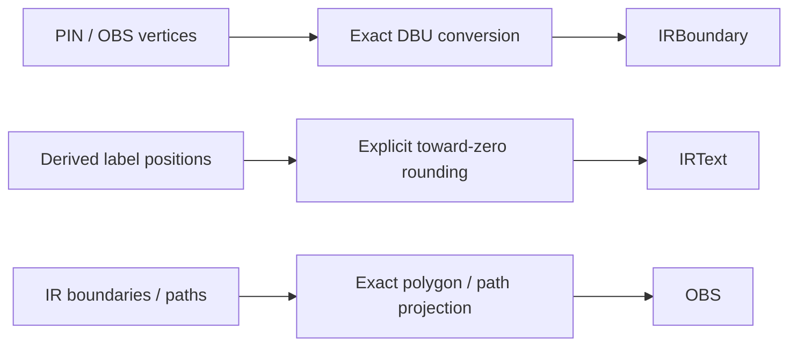

# LEF Geometry Conversion

## Purpose and Scope

Own `LEFIRConverter` and its internal coordinate conversion. Parent:
[LEF](../DESIGN.md). No children.

## Responsibilities and Boundaries

Preserve supported PIN/OBS physical vertices during micrometer-to-DBU import.
Generate pin labels with explicit rounding. This component does not interpret
foundry rules, select routing access points or establish process qualification.

## Related Designs

| Design | Relationship | Contract Used | Summary | Cautions |
|---|---|---|---|---|
| [LEF](../DESIGN.md) | Parent | LEFDocument and LEFError | Public conversion entry point | Broader interchange completeness remains separately tracked |
| [CircuiteFoundation](../../../../CircuiteFoundation/DESIGN.md) | Depends on | DatabaseUnitScale | Positive finite scale | Explicit display rounding does not authorize physical rounding |

## Architecture

## Contracts and Invariants

Named via output follows [ViaPlacement](../../LayoutIR/ViaPlacement/DESIGN.md):
without a bound master resolver, `IRElement.via` causes a typed failure before
serialization or document publication. No placement is silently skipped.

Typed LEF PORT VIA declarations remain retained by the source codec. This physical
projection has no bound master geometry/resolver and refuses ports containing
VIA before publishing geometry, rather than returning only their other shapes.

- Physical coordinates round to the nearest integer only when the difference is
  at most one ULP of the scaled Double, accounting for binary multiplication
  noise. Larger differences fail with a typed off-grid error.
- Non-finite values and values outside Int32 fail before integer conversion.
- Label positions explicitly round toward zero. This never changes physical
  vertices and permits labels for shapes with half-DBU centers.
- All conversion state is local to the synchronous call; no shared mutable state
  or target-dependent synchronization is introduced.
- Inverse projection preserves rectangular perimeters as RECT and other legal
  LEF polygon perimeters as POLYGON, never as a bounding box. Positive-width
  orthogonal half-width-extended paths become WIDTH/PATH. Other orthogonal path
  caps become exact segment RECT unions when their DBU surfaces are representable;
  round caps and nonorthogonal paths fail explicitly. Geometry annotations,
  text and hierarchy that this OBS projection cannot retain fail before publication.
  The same explicit refusal applies to nonempty library metadata.
- Source PATH widths and vertices use exact DBU conversion. Derived labels keep
  the existing explicit toward-zero policy; it does not authorize wire rounding.

## Failure, Concurrency, and Constraints

Conversion throws on the first invalid coordinate and publishes no partial
IRLibrary or LEFDocument. Integer range checks precede casts. Named via master
binding and electrical pin interpretation remain consumer responsibilities.

## Verification and Change Impact

[LEFIRConverterEdgeCaseTests](../../../Tests/LEFTests/LEFEdgeCaseTests.swift)
proves positive/negative off-grid rejection, floating-point exactness, derived
labels and overflow. LEFTests and package tests verify composition. Changes to
this policy require rechecking native consumers when they use this conversion;
names-only PDK inspection does not call this path.

[LEFGeometryPreservationTests](../../../Tests/LEFTests/LEFGeometryPreservationTests.swift)
checks actual standard polygon/path bytes, independent expected vertices and cap
surfaces, strict unsupported projection and source WIDTH/PATH admission.
