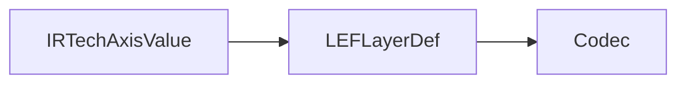

# LEF Physical Schema

## Purpose and Scope

Own `LEFLayerDef`, associated spacing/enclosure records and PORT/OBS path values.
Parent: [LEF](../DESIGN.md). No children.

## Responsibilities and Boundaries

Retain declared physical layer values. Use TechIR's shared axis value rather than
a lossy scalar projection. Rule evaluation belongs to domain engines.

## Related Designs

| Design | Relationship | Contract Used | Summary | Cautions |
|---|---|---|---|---|
| [LEF](../DESIGN.md) | Parent | Physical layer schema | Supported standard values | Missing declarations remain missing |
| [TechnologyGrid](../../TechIR/TechnologyGrid/DESIGN.md) | Depends on | IRTechAxisValue | Micrometer pitch/offset | No implicit axis selection |

## Architecture

## Contracts and Invariants

Scalar and X/Y pitch/offset declarations remain distinguishable. Optional rules
remain optional. Records have value ownership and identical semantics on all
targets.

LEFPath retains an explicit positive micrometer width and ordered orthogonal
points in LEFPort. One point represents a square; longer paths extend by half
the width at both ends. Paths are owned Sendable/Codable values on every target.
Older serialized LEFPort values without paths decode to an empty path list.
The existing LEFPort initializer labels remain available; the path-aware
initializer requires an explicit paths argument and retains the same value owner.

Layer properties retain typed assignment facts and optional subtype from
[TechnologyProperties](../../TechIR/TechnologyProperties/DESIGN.md). Source
assignment and semantic subtype must agree at LEF writer/projection boundaries.
Legacy layers decode empty properties and absent subtype.

Ordered antenna statements use [TechnologyAntenna](../../TechIR/TechnologyAntenna/DESIGN.md); legacy absence decodes empty. No effective rule copy or process verdict is stored.

Exact layer enclosure arrays use [TechnologyEnclosure](../../TechIR/TechnologyEnclosure/DESIGN.md); side and opposing overhang pairs are retained without scalar reduction.

Layer `resistance` remains routing sheet resistance in ohms per square.
`cutResistanceOhms` independently retains resistance of one cut in ohms; neither
quantity is a total-via resistance. These optional values have disjoint layer
contexts and cannot coexist. Legacy resistance JSON is never reinterpreted as a
cut quantity. [Codec](../Codec/DESIGN.md) owns source validation and spelling.

Unit-bearing scalar current-density arrays use [TechnologyCurrentDensity](../../TechIR/TechnologyCurrentDensity/DESIGN.md); electrical signoff owns their evaluation independently of geometric legality.

## Verification and Change Impact

LEF reader/writer and TechIR conversion tests own grid preservation. Native
consumers must validate process mapping and choose an axis explicitly.

Minimum enclosed hole-area raw facts use `minimumEnclosedAreas`, empty when absent.
[Codec](../Codec/DESIGN.md#minimum-enclosed-hole-area) owns the supported profile,
projection authority and validation. Values remain square microns.
