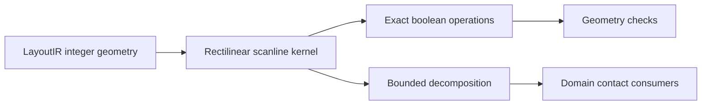

# MaskGeometry

## Purpose and Scope
Own integer physical geometry operations. Parent: [package](../../DESIGN.md).
Child: [RectilinearDecomposition](RectilinearDecomposition/DESIGN.md).

## Responsibilities and Boundaries
Own polygon boolean, sizing, connectivity and geometry checks. Domain conductor
roles, net identity, process qualification and electrical models belong to callers.

## Related Designs
| Design | Relationship | Contract Used | Summary | Cautions |
|---|---|---|---|---|
| [Package](../../DESIGN.md) | parent | LayoutIR geometry | Geometry product composition | No electrical qualification |
| [RectilinearDecomposition](RectilinearDecomposition/DESIGN.md) | child | Bounded integer decomposition/union bands | Shared scanline kernel | Existing boolean APIs do not inherit bounded admission |

## Architecture

## Contracts and Invariants
Boolean operations reject non-Manhattan geometry with typed failure. The
bounded decomposition entry point shares their scanline algorithm and preserves
integer coordinates, source polygon identity and even-odd coverage. The child
also owns checked cross-polygon union with a caller-owned aggregate budget;
its exact guarantee and five ceilings are defined only in that child contract.

## Verification and Change Impact
[MaskGeometryTests](../../Tests/MaskGeometryTests) owns geometry behavior.
Changes to shared scanline decomposition require the geometry target regression;
consumer contact and electrical correctness require independent domain evidence.
