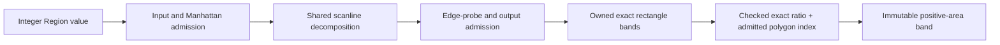

# RectilinearDecomposition

## Purpose and Scope
Own bounded exact scanline decomposition and cross-polygon union coverage of a
supplied Region value. Parent:
[MaskGeometry](../DESIGN.md). Electrical meaning remains with consuming domains.

## Responsibilities and Boundaries
Expose the existing RegionBoolean scanline kernel as integer rectangle bands,
with explicit admission and cancellation. Reuse the existing union row sweep,
interval coalescing and vertical merge for bounded cross-polygon union. Relocate validated bands by an exact
positive integer ratio and caller-supplied polygon index. Do not quantize source coordinates,
infer conductor layers, construct contacts or calculate electrical parameters.

## Related Designs
| Design | Relationship | Contract Used | Summary | Cautions |
|---|---|---|---|---|
| [MaskGeometry](../DESIGN.md) | parent | Exact rectilinear kernel | Same algorithm as boolean operations | Unsupported angles throw |
| [LayoutVerify](../../../../semiconductor-layout/Sources/LayoutVerify/DESIGN.md) | used by | Integer physical geometry | Native contact capture consumes bands | Consumer owns exact grid conversion and topology |

## Architecture


## Contracts and Invariants
`Region.rectilinearBands` retains each source polygon index and emits positive-area
bands in polygon order, ascending y rows and ascending x intervals. Coverage is
the existing kernel's even-odd fill; holes remain empty. Bands are not unioned
across source polygons. Consumers must avoid double-counting overlapping inputs.
All Int32 endpoints remain exact; midpoint sampling uses Double only to select
between adjacent integer y rows, not to interpolate or round coordinates.
Non-Manhattan geometry, invalid limits, resource exhaustion and cancellation
throw typed errors. Failure returns no partial output.

Limits belong to the caller. Input entries count one per polygon plus each
stored vertex. Edge probes count each source edge inspected at a scanline row.
Output bands count rectangles before append. The default host policy admits
one million input entries, eight million edge probes and one million output
bands. These are admission ceilings, not workload qualification. Sorting is
bounded by the admitted input; cancellation is checked before/after sorting,
before each polygon, at every edge probe and every output append.
Degenerate rectilinear polygons have empty coverage; consumers own whether that
is an admissible physical input. No bbox or approximate polygon fallback exists.

`RectilinearBand.relocated(toPolygonIndex:coordinateNumerator:coordinateDenominator:)`
accepts only an existing validated band, a nonnegative replacement polygon index,
and positive Int64 numerator and denominator. Each of its four Int32 endpoints
is widened, multiplied with Int64 overflow checking, divided only when the
remainder is zero, and admitted only when the quotient is representable as
Int32. Checked multiplication occurs before division even for reducible ratios.
Positive exact scaling preserves endpoint order and positive area. The operation
returns a new immutable value without geometry decomposition, allocation or
coordinate rounding, with constant time and space over four endpoints. Invalid
parameters, multiplication overflow, a nonzero remainder and Int32 range failure
are distinct typed errors; failure publishes no relocated band. The source value
is unchanged. Polygon ownership and the physical meaning of coordinate ratios
belong to the consuming domain; this portable API does not admit physical units.

## Shared Union Contract

`Region.rectilinearUnionBands(toPolygonIndex:budget:isCancelled:)` consumes one
caller-owned `inout RectilinearUnionBudget` initialized with explicit
`RectilinearUnionLimits`. The same value spans all calls in one caller generation;
the callee never replenishes it. Budget counters are publicly readable and only
the geometry owner may spend them. A negative limit or replacement polygon
index fails explicitly. Failed calls retain all previously spent admission and
work; no partial output is returned. The caller owns physical grouping and the
meaning of the replacement index; source polygon provenance is intentionally
replaced only in this union API.

| Ceiling | Charge boundary | Allocation/work guarantee |
|---|---|---|
| Input entries | One polygon plus its stored vertices before traversal/copies | Source admission bounds normalized points, Y sets and source sorting |
| Edge probes | Before each source edge inspected by decomposition | Bounds actual scanline decomposition visits |
| Intermediate bands | Before each decomposed band append | Bounds the sweep input, event staging and active storage |
| Sweep work | Before each band validation, event staging, active eviction/insertion/emission, interval or vertical merge visit | Bounds shared traversal visits, not every CPU instruction |
| Output bands | Before each provisional union row append | Bounds provisional and final output, even when later vertical merge reduces count |

The source Region is already caller-owned and its creation is outside these
allocation guarantees. Sorting is bounded by admitted source, intermediate and
provisional output sizes. Cancellation is checked before and after sorting and
at every charged visit/append; sort comparator work is not charged or interruptible.
The composite work bound is admitted sorting plus charged source/sweep visits.
All counters use checked admission before subtraction or append; spent counters
are never refunded after an error.

Union uses each polygon's existing even-odd fill, then coalesces overlapping and
abutting intervals across polygons. Equal-X vertically adjacent rows merge using
the existing kernel. Output is deterministic in ascending `(minX,maxX,minY)`
order, has positive area, exact Int32 endpoints, no overlapping area, and the
caller-supplied polygon index. Holes, concavity, disconnected pieces and genuine
empty coverage are preserved. There is no bbox or approximate fallback.

## Runtime Flows

```text
caller-owned aggregate budget + integer Region
    -> shared source admission/decomposition -> admitted intermediate bands
    -> shared event sweep/interval union -> admitted provisional rows
    -> shared vertical merge -> immutable union bands with caller-owned index
```

## State, Ownership, and Lifecycle
Mutable counters and output storage are local to a synchronous call. Source
and output are Sendable values. No pointer or shared state escapes. The caller
supplies a synchronous cancellation predicate; no host Task runtime is required
by the portable geometry kernel.

## Failure, Concurrency, and Constraints
Input and output limits bound temporary/output arrays; edge-probe limits bound
scanline expansion. Callback failures do not publish bands. Existing unbounded
boolean APIs retain their contract and delegate to the same scanline traversal;
only the bounded entry points establish these resource guarantees. The union
budget is a Sendable value exclusively borrowed by synchronous inout calls; it
has no shared storage, conditional synchronization or retained callback.

## Verification and Change Impact
[RectilinearDecompositionTests](../../../Tests/MaskGeometryTests/RectilinearDecompositionTests.swift)
checks exact concave/holed coverage, integer endpoints, malformed capability,
limits and mid-operation cancellation. Its relocation tests use publicly
decomposed bands and check identity, reindexing, negative coordinates, exact
roundtrips, parameter rejection, Int64 multiplication boundaries, nonzero
remainders and Int32 result boundaries. [RectilinearUnionTests](../../../Tests/MaskGeometryTests/RectilinearUnionTests.swift)
checks union coverage against independent exact rectangle expectations and public
legacy boolean parity, overlapping/abutting/duplicate/reordered pieces, holes,
Int32 endpoints, all five ceilings, aggregate consumption after failure,
provisional-row admission and cancellation without publication. MaskGeometry
regression owns shared scanline/boolean behavior. Downstream LayoutVerify must separately verify cut,
layer, occurrence and terminal semantics; this proof establishes no RC result.
