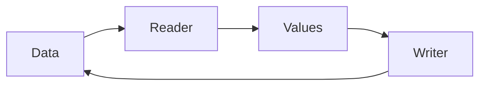

# OASIS Binary Coding

## Purpose and Scope
Parent: [OASIS](../DESIGN.md). This component owns byte buffering, integer, real, string, point-list, repetition and compressed-block primitives. No children.

## Responsibilities and Boundaries
The reader/writer are caller-owned value types. No shared mutable state or implicit library modality is held here.

## Related Designs
| Design | Relationship | Contract Used | Summary | Cautions |
|---|---|---|---|---|
| [OASIS](../DESIGN.md) | parent | Standard primitives | Module composition | Platform qualification remains separate |
| [LibraryCodec](../LibraryCodec/DESIGN.md) | used by | Checked decoding and exact encoding | Record payloads | Coordinate accumulation belongs to the caller |

## Architecture

## Contracts and Invariants
Signed integers encode magnitude with a low sign bit, including Int64.min without intermediate overflow. Reads reject truncation and values outside the destination range. Type-3 point lists use SW direction 6 and SE direction 7. Type-4 point lists use the same g-delta codec as repetition. Collection limits remain enforced before allocation. Property scalars use the standard value type codes; real properties do not carry a second real type code. Unrepresented reference kinds fail explicitly.

## State, Ownership, and Lifecycle
Data storage and cursor belong to one value instance. Scoped compression borrows do not escape. This change adds no pointer storage or concurrent state.

## Failure, Concurrency, and Constraints
Numeric overflow and truncated bytes are typed errors. Callers must supply representable IR deltas; no clipping or fallback is allowed.

## Verification and Change Impact
[OASISStandardCodingTests](../../../Tests/OASISTests/OASISStandardCodingTests.swift) asserts independent literal bytes, signed boundaries, directions, and truncation. Primitive changes affect LibraryCodec and every OASIS consumer; package regression checks other callers.
