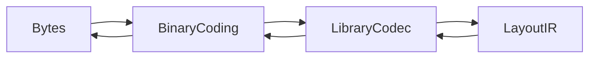

# OASIS

## Purpose and Scope
The OASIS module owns standard binary interchange. Parent: [package](../../DESIGN.md). Children: [BinaryCoding](BinaryCoding/DESIGN.md) and [LibraryCodec](LibraryCodec/DESIGN.md).

## Responsibilities and Boundaries
The module translates standard bytes to LayoutIR without rounding signed coordinates, units, or endpoint extensions. It does not interpret process rules or qualify extraction.

## Related Designs
| Design | Relationship | Contract Used | Summary | Cautions |
|---|---|---|---|---|
| [Package](../../DESIGN.md) | parent | Lossless standard interchange | Domain-neutral ownership | Unsupported semantics fail explicitly |
| [BinaryCoding](BinaryCoding/DESIGN.md) | child | Bounded primitive coding | Standard byte representation | Own-reader round trips are insufficient |
| [LibraryCodec](LibraryCodec/DESIGN.md) | child | Cell-scoped record composition | LayoutIR conversion | Modal values reset at cell boundaries |
| [LayoutIO](../../../semiconductor-layout/Sources/LayoutIO/DESIGN.md) | used by | Exact LayoutIR geometry | Physical coordinate conversion | Consumer pins a verified revision |

## Architecture

## Contracts and Invariants
Units are database units per micrometer. Signed integers use sign and magnitude. Omitted PATH fields reuse defined cell-local values. Begin and end extensions are independent; unresolved modality, overflow, unsupported caps, and malformed envelopes fail before publishing a library.

## Verification and Change Impact
[OASISTests](../../Tests/OASISTests) owns literal-byte fixtures, malformed-input rejection and output-byte assertions. Independent reader evidence verifies exported physical dimensions. Layout consumers additionally verify imported conductor footprints; codec tests alone do not qualify native extraction or other targets.
