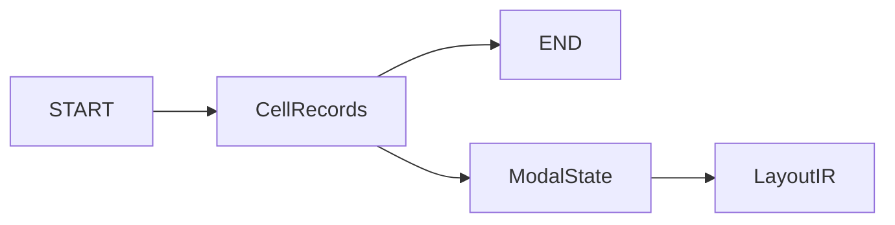

# OASIS Library Codec

## Purpose and Scope
Parent: [OASIS](../DESIGN.md). Owns library record composition, START/END, cell-local modality, and LayoutIR conversion. No children.

## Responsibilities and Boundaries
Binary primitives are delegated to [BinaryCoding](../BinaryCoding/DESIGN.md). Endpoint extensions are resolved numerical values owned by each cell's modal state. Geometry, text, and placement have separate coordinate families sharing one absolute/relative mode.

## Related Designs
| Design | Relationship | Contract Used | Summary | Cautions |
|---|---|---|---|---|
| [OASIS](../DESIGN.md) | parent | Exact record interpretation | Module composition | Success is limited to supported records |
| [BinaryCoding](../BinaryCoding/DESIGN.md) | depends on | Checked integer and point-list coding | Payload representation | No alternative private integer codec |

## Architecture

## Contracts and Invariants

Named via output follows [ViaPlacement](../../LayoutIR/ViaPlacement/DESIGN.md):
without a bound master resolver, `IRElement.via` causes a typed failure before
serialization or document publication. No placement is silently skipped.

START units are DBU per micrometer. Offset flag 0 places twelve table values in START; flag 1 places them in END. Writer emits flag 1 and a 256-byte END with validation scheme 0. Reader requires END and rejects unsupported validation rather than claiming verification.
PATH scheme bits 3:2 own begin and bits 1:0 own end: 0 reuses, 1 resolves zero, 2 resolves the current half-width, 3 reads an explicit signed value. Begin explicit bytes precede end bytes. Omitted scheme retains the resolved values even after a width change. An explicit value remains custom even when numerically zero or half-width; other asymmetric retained values become custom. PATH point lists reuse independently of polygon lists. Required unset modalities fail; coordinates start at zero.

TEXT has no standard transform fields. Nonidentity IRText transforms fail before
successful output; GDS TEXT pose support is unaffected. Named string properties
(attribute zero, `name=value`) retain order, duplicates and empty values. CELL
properties are emitted immediately after CELL and retained separately from
element properties, including PROPERTY_REPEAT. Property modality is cell-local.
An element record owns all of its expanded repetitions; PAD does not change that
owner, and subsequent properties apply to the whole expanded range.
Positive numeric GDS element attributes retain number and string through standard
S_GDS_PROPERTY. They are not named-property or cell-property authority. Unsupported
property kinds and negative attributes fail explicitly rather than coalescing scopes.

IRLibrary.metadata owns unique generic file-scope names with one string value.
Writer emits these properties immediately after START, before name/string tables;
reader retains names and values directly rather than splitting an encoded pair.
Empty values and equals signs in names/values are preserved. Duplicate file names,
nonstring/multiple values, standard typed properties and unsupported table-scoped
properties fail rather than being flattened into the string map. File property
modality is call-local and separate from cell property modality.

## Runtime Flows
Read width, resolve both extensions, resolve point list, update geometry coordinates, expand repetition, attach properties, then publish IR. Relative coordinate updates use checked addition. Text and placement cannot modify geometry origin. New cells reset all modality.

## State, Ownership, and Lifecycle
All modal state is local to readCellContents; no state survives cell or library boundaries. Output is assembled locally and returned only after successful serialization.

## Failure, Concurrency, and Constraints
Undefined required PATH modality, invalid extension scheme, unrepresentable width/coordinate/extension, unsupported round caps and malformed envelopes produce typed errors. Custom export requires both endpoint fields; noncustom export rejects ignored endpoint fields. Inline path property strings use standard type 10. Unresolved property-string references fail explicitly; complete typed property/schema interchange remains outside this path qualification. Existing repetition limits remain enforced.

## Verification and Change Impact
[OASISStandardCodingTests](../../../Tests/OASISTests/OASISStandardCodingTests.swift) owns literal scheme/modal/envelope fixtures and writer assertions. Independent gdstk reads verify precision, origins, widths and signed caps. Exact dependency adoption in semiconductor-layout and PEXEngine owns cumulative electrical behavior.

[OASISSemanticPreservationTests](../../../Tests/OASISTests/OASISSemanticPreservationTests.swift)
owns literal CELL property scope/repeat fixtures, exact named-property round trips
and transformed TEXT refusal. No mutable storage or target-dependent conformance
is introduced.
