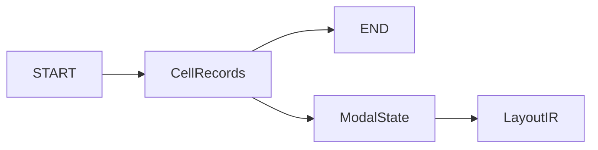

# OASIS Library Codec

## Purpose and Scope
Parent: [OASIS](../DESIGN.md). Owns library record composition, START/END, cell-local modality, and LayoutIR conversion. No children.

## Responsibilities and Boundaries
Binary primitives are delegated to [BinaryCoding](../BinaryCoding/DESIGN.md). Endpoint extensions are resolved numerical values owned by each cell's modal state. Geometry, text, and placement have separate coordinate families sharing one absolute/relative mode.

## Related Designs
| Design | Relationship | Contract Used | Summary | Cautions |
|---|---|---|---|---|
| [OASIS](../DESIGN.md) | parent | Exact record interpretation | Module composition | Success is limited to supported records |
| [BinaryCoding](../BinaryCoding/DESIGN.md) | depends on | Checked integer and point-list coding | Payload representation | No alternative private integer codec |

## Architecture

## Contracts and Invariants
START units are DBU per micrometer. Offset flag 0 places twelve table values in START; flag 1 places them in END. Writer emits flag 1 and a 256-byte END with validation scheme 0. Reader requires END and rejects unsupported validation rather than claiming verification.
PATH scheme bits 3:2 own begin and bits 1:0 own end: 0 reuses, 1 resolves zero, 2 resolves the current half-width, 3 reads an explicit signed value. Begin explicit bytes precede end bytes. Omitted scheme retains the resolved values even after a width change. An explicit value remains custom even when numerically zero or half-width; other asymmetric retained values become custom. PATH point lists reuse independently of polygon lists. Required unset modalities fail; coordinates start at zero.

## Runtime Flows
Read width, resolve both extensions, resolve point list, update geometry coordinates, expand repetition, attach properties, then publish IR. Relative coordinate updates use checked addition. Text and placement cannot modify geometry origin. New cells reset all modality.

## State, Ownership, and Lifecycle
All modal state is local to readCellContents; no state survives cell or library boundaries. Output is assembled locally and returned only after successful serialization.

## Failure, Concurrency, and Constraints
Undefined required PATH modality, invalid extension scheme, unrepresentable width/coordinate/extension, unsupported round caps and malformed envelopes produce typed errors. Custom export requires both endpoint fields; noncustom export rejects ignored endpoint fields. Inline path property strings use standard type 10. Unresolved property-string references fail explicitly; complete typed property/schema interchange remains outside this path qualification. Existing repetition limits remain enforced.

## Verification and Change Impact
[OASISStandardCodingTests](../../../Tests/OASISTests/OASISStandardCodingTests.swift) owns literal scheme/modal/envelope fixtures and writer assertions. Independent gdstk reads verify precision, origins, widths and signed caps. Exact dependency adoption in semiconductor-layout and PEXEngine owns cumulative electrical behavior.
