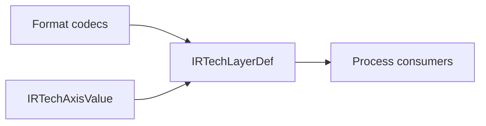

# TechIR

## Purpose and Scope

Own format-neutral technology values. Parent: [package](../../DESIGN.md).
Child: [TechnologyGrid](TechnologyGrid/DESIGN.md).

## Responsibilities and Boundaries

Retain technology declarations independently of parsers and engine policy.
Qualification and physical algorithms are consumer responsibilities.

## Related Designs

| Design | Relationship | Contract Used | Summary | Cautions |
|---|---|---|---|---|
| [Package](../../DESIGN.md) | Parent | Standard-data boundary | Independent public product | Not a qualification service |
| [TechnologyGrid](TechnologyGrid/DESIGN.md) | Child | Layer grid values | Scalar and X/Y representation | Both axes must survive conversion |
| [LEF](../LEF/DESIGN.md) | Used by | Technology layer records | Parser-independent projection | Other projection limitations require separate evidence |

## Architecture

## Contracts and Invariants

Layer pitch and offset use micrometers and preserve the distinction between a
single scalar and two explicit axis values. No default axis is discarded.

## Verification and Change Impact

[TechIRTests](../../Tests/TechIRTests) verifies values and serialization.
[LEFTests](../../Tests/LEFTests) verifies standard conversion. Consumers must
update their axis selection when the public grid representation changes.
