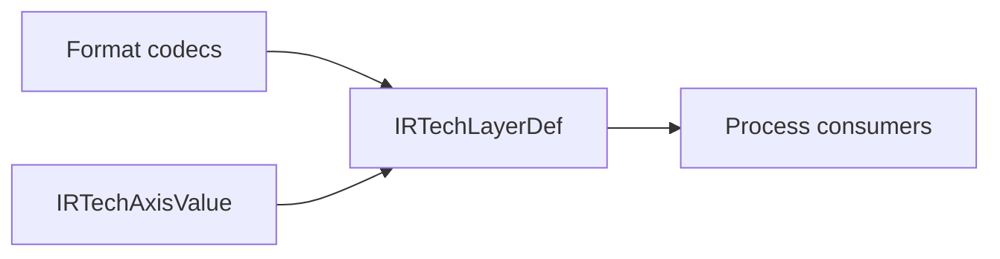

# TechIR

## Purpose and Scope

Own format-neutral technology values. Parent: [package](../../DESIGN.md).
Children: [TechnologyGrid](TechnologyGrid/DESIGN.md) and
[TechnologyUnits](TechnologyUnits/DESIGN.md) and [TechnologyProperties](TechnologyProperties/DESIGN.md), and [TechnologyAntenna](TechnologyAntenna/DESIGN.md), and [TechnologyEnclosure](TechnologyEnclosure/DESIGN.md), and [TechnologyCurrentDensity](TechnologyCurrentDensity/DESIGN.md), and [TechnologyViaGeneration](TechnologyViaGeneration/DESIGN.md).

## Responsibilities and Boundaries

Retain technology declarations independently of parsers and engine policy.
Qualification and physical algorithms are consumer responsibilities.

## Related Designs

| Design | Relationship | Contract Used | Summary | Cautions |
|---|---|---|---|---|
| [Package](../../DESIGN.md) | Parent | Standard-data boundary | Independent public product | Not a qualification service |
| [TechnologyGrid](TechnologyGrid/DESIGN.md) | Child | Layer grid values | Scalar and X/Y representation | Both axes must survive conversion |
| [TechnologyUnits](TechnologyUnits/DESIGN.md) | Child | Retained unit declarations | Shared precision records | Codecs own grammar; numerical models own SI interpretation |
| [LEF](../LEF/DESIGN.md) | Used by | Technology layer records | Parser-independent projection | Other projection limitations require separate evidence |

| [TechnologyProperties](TechnologyProperties/DESIGN.md) | Child | Property definitions, assignments and subtypes | Retained typed source and classification facts | Process application is consumer-owned |

| [TechnologyAntenna](TechnologyAntenna/DESIGN.md) | Child | Ordered oxide/ratio declarations | Retained source laws | Consumers own actual process evaluation |

| [TechnologyEnclosure](TechnologyEnclosure/DESIGN.md) | Child | Exact enclosure side and overhang pairs | Shared retained facts | Scalar legacy rules cannot replace directional declarations |

| [TechnologyCurrentDensity](TechnologyCurrentDensity/DESIGN.md) | Child | Unit-bearing DC/AC scalar limits | Retained electrical facts | Electrical interpretation is independent of geometric legality |

| [TechnologyViaGeneration](TechnologyViaGeneration/DESIGN.md) | Child | Exact formula records | Ordered viaGenerationRules independent of instantiated vias | Consumer admission and materialization are separate |

## Architecture

## Contracts and Invariants

Layer pitch and offset use micrometers and preserve the distinction between a
single scalar and two explicit axis values. No default axis is discarded.

The optional library-level `manufacturingGrid` retains a micron grid independent
of database units. Serialization preserves absence in older values. LEF
projection must retain it in both directions; process legality is consumer-owned.

Optional `obstructionSpacingUsesMinimumWidth` retains source policy presence
without changing obstruction geometry. [LEF Codec](../LEF/Codec/DESIGN.md) owns
its ON/OFF grammar; process consumers own its spacing interpretation.

[TechnologyGrid](TechnologyGrid/DESIGN.md) retains routing sheet resistance and per-cut ohms as separate optional quantities; physical consumers own actual network evaluation.

## Verification and Change Impact

[TechIRTests](../../Tests/TechIRTests) verifies values and serialization.
[LEFTests](../../Tests/LEFTests) verifies standard conversion. Consumers must
update their axis selection when the public grid representation changes.

`IRTechDesignRule.minEnclosedArea` is an optional unconditional minimum empty
hole area in square microns, distinct from metal island `minArea`. Absence is
nil, including legacy JSON. [LEF Codec](../LEF/Codec/DESIGN.md#minimum-enclosed-hole-area)
owns the supported source profile and lossless reverse refusal boundary.
