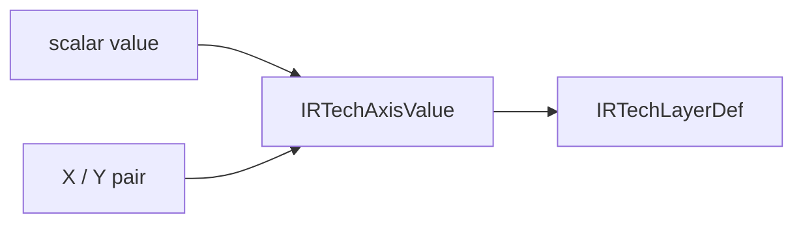

# Technology Grid

## Purpose and Scope

Own `IRTechLayerDef` and `IRTechAxisValue`. Parent: [TechIR](../DESIGN.md).
No children.

## Responsibilities and Boundaries

Represent layer grid declarations without parser or routing policy. Values are
micrometers. Selecting horizontal versus vertical track coordinates belongs to
the engine, using Y versus X respectively.

## Related Designs

| Design | Relationship | Contract Used | Summary | Cautions |
|---|---|---|---|---|
| [TechIR](../DESIGN.md) | Parent | Layer value schema | Public technology values | Scalar applies uniformly; X/Y retains both declared values |

## Architecture

## Contracts and Invariants

The enum admits exactly one scalar or one complete X/Y pair. Serialization keeps
that distinction. Pitch and offset are independent optional declarations; absent
values remain absent. All values have local value ownership and no shared state.

Layer properties and optional subtype use [TechnologyProperties](../TechnologyProperties/DESIGN.md). Retention grants no process-rule admission; legacy layers decode empty properties and absent subtype.

Ordered antenna statements use [TechnologyAntenna](../TechnologyAntenna/DESIGN.md); legacy absence decodes empty. No effective rule copy or process verdict is stored.

Exact layer enclosure arrays use [TechnologyEnclosure](../TechnologyEnclosure/DESIGN.md); side and opposing overhang pairs are retained without scalar reduction.

`resistance` retains routing sheet resistance in ohms per square;
`cutResistanceOhms` retains one cut's resistance in ohms. Both are optional and
remain separate from total-via resistance. Codecs must validate routing/cut
contexts and refuse contradictory simultaneous quantities. Missing legacy cut
resistance decodes absent; existing resistance is never recast into a cut value.
No UNITS precision factor rescales these physical quantities during projection.

Unit-bearing scalar current-density arrays use [TechnologyCurrentDensity](../TechnologyCurrentDensity/DESIGN.md); electrical signoff owns their evaluation independently of geometric legality.

## Verification and Change Impact

LEF reader/writer/TechIR round trips verify asymmetric axis values and offsets.
Changing the representation requires updating LEF and native track consumers.
