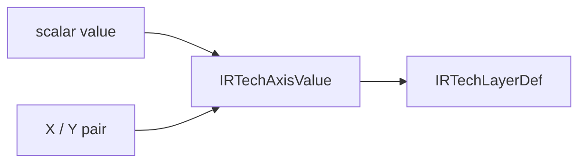

# Technology Grid

## Purpose and Scope

Own `IRTechLayerDef` and `IRTechAxisValue`. Parent: [TechIR](../DESIGN.md).
No children.

## Responsibilities and Boundaries

Represent layer grid declarations without parser or routing policy. Values are
micrometers. Selecting horizontal versus vertical track coordinates belongs to
the engine, using Y versus X respectively.

## Related Designs

| Design | Relationship | Contract Used | Summary | Cautions |
|---|---|---|---|---|
| [TechIR](../DESIGN.md) | Parent | Layer value schema | Public technology values | Scalar applies uniformly; X/Y retains both declared values |

## Architecture

## Contracts and Invariants

The enum admits exactly one scalar or one complete X/Y pair. Serialization keeps
that distinction. Pitch and offset are independent optional declarations; absent
values remain absent. All values have local value ownership and no shared state.

## Verification and Change Impact

LEF reader/writer/TechIR round trips verify asymmetric axis values and offsets.
Changing the representation requires updating LEF and native track consumers.
